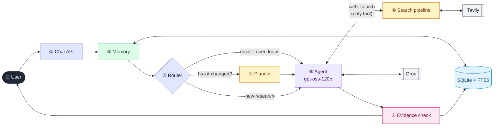
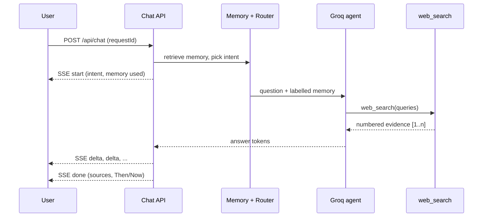
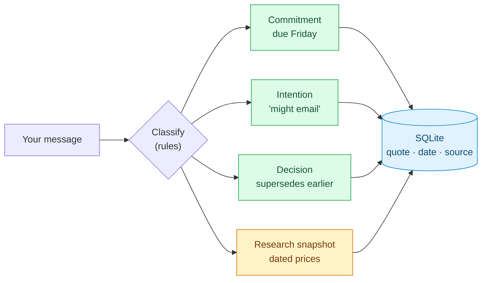
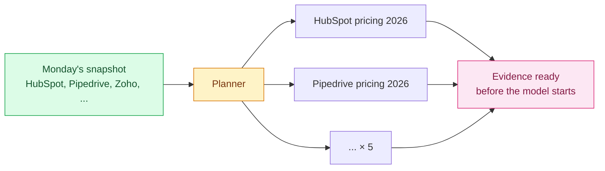
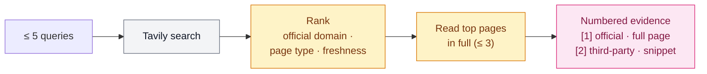
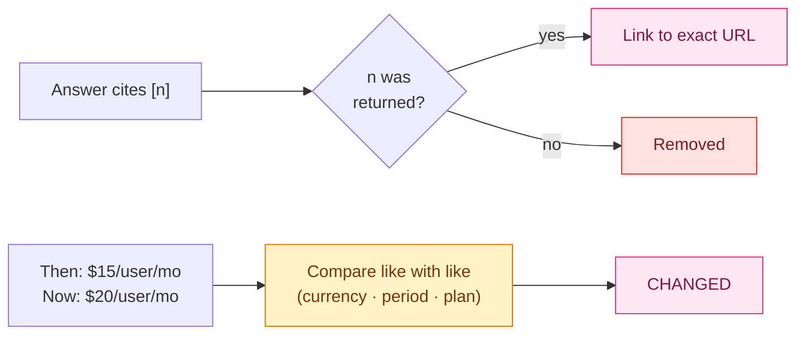

# Ichnora — Design

Ichnora is a personal knowledge and research assistant that **remembers what you asked and when**, and can tell you whether an earlier answer still holds. It uses one model (Groq `gpt-oss-120b`) and exactly one tool, `web_search`. Everything that must be *exactly right* (dates, history, commitments, sources, price comparisons) is handled by deterministic, tested application code over SQLite. The model's job is to understand the question and write a clear answer.

> **Reading guide:** start with the overview below. Each numbered part has a **details** link that jumps to its section. Click the grey <kbd>▶ click to expand</kbd> button (or anywhere on that line) to open the deep dive and its diagram.

## 1. Overview

| # | Component | One line | Deep dive |
|---|---|---|---|
| ① | Chat API | Streams each turn over SSE. Retried requests are idempotent. | [**▶ open**](#c1) |
| ② | Memory engine | Exact recall by date or topic, commitments and decisions. | [**▶ open**](#c2) |
| ③ | Router | Decides whether a question needs the web at all. | [**▶ open**](#c3) |
| ④ | Search planner | Pre-builds one search per product for change checks. | [**▶ open**](#c4) |
| ⑤ | Agent loop | One model, one tool, at most 3 rounds, token-paced. | [**▶ open**](#c5) |
| ⑥ | Search pipeline | Search, rank official pages first, read the best ones in full. | [**▶ open**](#c6) |
| ⑦ | Evidence check | Verifies citations and computes Then → Now in code. | [**▶ open**](#c7) |

## 2. Zoom in

<b>① Chat API</b>: one turn, streamed end to end &nbsp;<kbd>▶ click to expand</kbd>

- Turns are serialised per conversation, and a repeated `requestId` replays the stored answer instead of running again.
- Messages are immutable, with a UTC timestamp, the timezone and the local date.

<b>② Memory engine</b>: what you asked, promised and decided &nbsp;<kbd>▶ click to expand</kbd>

- **Retrieval:** SQL handles dates and statuses, FTS5 handles topics, and scoring resolves references like "them" to an earlier shortlist.
- **Provenance:** every memory keeps the user's original quote. "I sent it" closes the matching commitment and links the evidence.

<b>③ Router</b>: search only when it adds something &nbsp;<kbd>▶ click to expand</kbd>

| Intent | Example | Tool policy |
|---|---|---|
| chat | "thanks!" | none |
| recall | "What did I ask on 3 November?" | none |
| open_loops | "What's pending?" | none |
| decision_history | "How has my database choice changed?" | none |
| recall_and_verify | "Has any of them changed?" | **required** |
| research | "Compare Postgres hosts" | model decides |

Routing is deterministic and tested, with 0 unnecessary searches in the evaluation suite.

<b>④ Search planner</b>: five products, one model round &nbsp;<kbd>▶ click to expand</kbd>

The app already knows what a re-check needs, so it runs those searches first. Measured live: a CRM re-check went from **103 s / 12.4K tokens to 48.5 s / 6.0K tokens**, in one model round.

<b>⑤ Agent loop</b>: one model, one tool, bounded &nbsp;<kbd>▶ click to expand</kbd>

- At most 3 rounds. The final round receives the evidence as plain context, so the model writes an answer instead of calling the tool again.
- A token gate paces requests under Groq's 8K tokens-per-minute free tier, so a burst of questions waits instead of failing.
- Reasoning effort is `low` by default and `medium` for change checks.

<b>⑥ Search pipeline</b>: inside the single <code>web_search</code> tool &nbsp;<kbd>▶ click to expand</kbd>

A credit ledger tracks Tavily's 1,000 monthly credits and keeps a reserve for change checks.

<b>⑦ Evidence check</b>: citations and Then → Now, computed in code &nbsp;<kbd>▶ click to expand</kbd>

Each item gets one of three verdicts: **CHANGED**, **NO MATERIAL CHANGE FOUND** or **UNABLE TO VERIFY**. Missing evidence is never read as "no change".

## 3. The three example questions

| Question | What happens | Web search? |
|---|---|---|
| *"What did I ask you on 3 November? Is your answer still correct today?"* | The date is resolved in the user's timezone, and the question comes back word for word with its saved answer and sources. Those sources are then re-checked. | Recall: no. Re-check: yes |
| *"On Monday we shortlisted 5 CRM tools… Has any of them changed?"* | "Them" is resolved to Monday's shortlist. The planner searches each product, and the app compares prices line by line. | Yes, planned |
| *"Last Tuesday I asked about Postgres hosting. Has pricing changed?"* | The conversation is found by date and topic, and its prices become the baseline. | Yes, planned |

## 4. Key decisions and alternatives

| Decision | Instead of | Why |
|---|---|---|
| Memory in application code | Memory as a second tool | Keeps the one-tool rule and saves a model round-trip on every turn. |
| SQL + FTS5 | Vector database | "On 3 November" and "overdue" are exact questions, and SQL answers them exactly. |
| Own `web_search` over Tavily | Gemini grounding, Groq `browser_search` | Works on free tiers and keeps the source details needed for verification. |
| Then → Now computed in code | Model judges what changed | Same evidence always gives the same verdict, and it is testable. |
| Single bounded agent | Planner/critic multi-agent | Fewer tokens, lower latency, the same answer quality. |
| No search-result cache | Caching | A cached result can't answer "is it still correct today?". |

## 5. Results

- **Deterministic suite:** 242 tests, plus a labelled evaluation suite ([EVALUATION.md](EVALUATION.md)):
  - commitment extraction: 100% precision and recall
  - routing: 100% correct intent
  - dates: 14/14 correct across timezones
  - change detection: 10/10 correct verdicts
- **Live:** all three example questions pass end to end against real Groq and Tavily ([eval/live.md](eval/live.md)).

## 6. With another week

- Target each vendor's official domain in planned re-checks.
- Have the model return then/now values as schema-validated JSON.
- Add rolling summaries for long conversations.
- Use small local embeddings for paraphrased recall ("that database thing").
