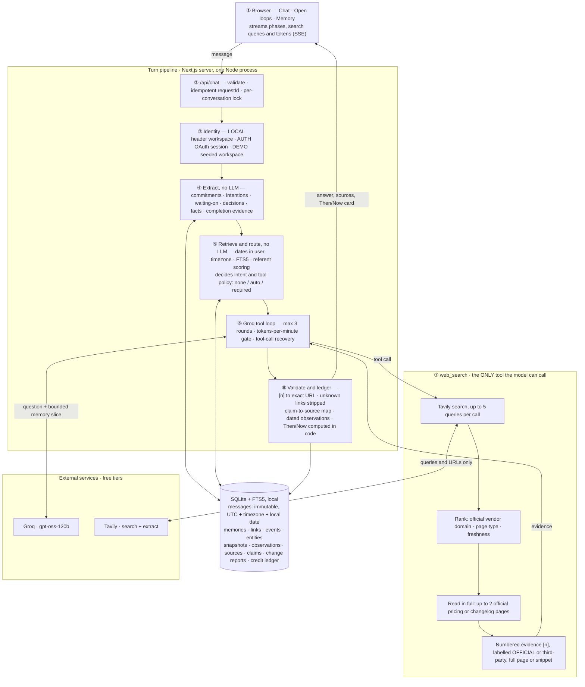

# Minimi — Design

**One model, one tool, and a deterministic application around them.** Groq `openai/gpt-oss-120b` is given exactly one function, `web_search`. Everything that has to be *right* rather than *fluent* is plain, tested TypeScript over SQLite: what you asked and when, what you promised, what you decided, which sources were really read, and whether a price really changed. The model gets a small, labelled slice of that state and writes the answer.

## Architecture

## How a turn works
1. **Persist first.** ②–③ The message is stored before anything else, with UTC time, the browser's IANA timezone (default `Asia/Kolkata`) and the derived *local* date. Retries with the same `requestId` never duplicate it, and turns in one conversation run strictly in order.
2. **Remember what you said.** ④ A rule-based classifier turns *your* sentences (never the model's) into typed memories, each with the verbatim quote and source message. "I'll send the proposal to Rahul by Friday" becomes an OPEN commitment due on the coming Friday. "I might email Priya" is only an intention. "I sent Rahul the proposal" closes the matching commitment and links the evidence. When a match is ambiguous, nothing is closed.
3. **Decide what this question needs.** ⑤ Dates are resolved in code ("3 November", "last Tuesday", "yesterday" in *your* timezone). Then:
   - **Recall**, **open loops** and **decision history** are answered from SQL with **no search**: fast, free and exact.
   - **"Has it changed / still correct?"** finds the baseline (date hit, an earlier turn, or a pronoun like "them" resolved by scoring snapshots) and **requires** a search.
   - When two different topics fit equally, the agent asks a clarifying question instead of guessing.
4. **Research.** ⑥–⑦ The model sees only the question, a bounded memory block marked as untrusted data, and one tool. A single call batches up to 5 queries (gpt-oss on Groq cannot call tools in parallel), so "check all five CRMs" is one round. The tool ranks results, reads the official pricing or changelog page in full when the question is about prices or releases, and labels every result.
5. **Trust nothing by default.** ⑧ The model cites `[n]`, and the app resolves each number to the exact URL of result *n*. A link to anything search did not return is removed. Prices in the answer become dated observations (amount, currency, monthly vs annual billing, seat, tier, effective date, evidence level). For change checks, the **app** compares them with the stored baseline and labels each item CHANGED, NO MATERIAL CHANGE FOUND or UNABLE TO VERIFY:
   - different plans or billing bases are never compared;
   - missing evidence is never reported as "no change";
   - a price "effective 1 Dec" is reported as scheduled, not as changed today.

## Why this design
- **Correctness lives in code, not in the prompt.** Dates, memory, citations and comparisons are where chat agents fail quietly, so each one is a pure function with a test. The model does what it is good at: understanding the question and writing the answer.
- **One tool, by choice.** Memory as a model tool would add a round-trip, cost tokens, and let the model decide whether to remember. Retrieval before the call is deterministic and nearly free. The single tool hides a small pipeline (search → rank → read → label) the model never has to orchestrate.
- **Planned re-checks.** For a change check with a known baseline, the app already knows what to verify: each entity's current pricing and/or releases. It runs those searches itself, through the same internal pipeline, and the model answers from that evidence in one round. This is search *planning*, not a second tool. The model still only ever sees `web_search`.
- **Fast where it can be.** Most personal questions skip search entirely (recall answered in about 2 s live). Research batches its queries and is capped at 3 model rounds, and free-tier limits are paced proactively rather than hit and retried.
- **SQL + FTS5 instead of a vector DB.** The hard questions are structural ("on 3 November", "overdue", "superseded MongoDB", "which five products"), and SQL answers them exactly. No test case needed semantic similarity, which would add a model and nondeterminism.
- **Honest under limits.** When Tavily credits (persisted ledger, with a reserve kept for change checks) or Groq quotas run out, the answer says so and marks values unverified. Recall, open loops and decisions keep working.

## Considered and rejected
- **Multi-agent planner/critic loops:** more tokens and latency on an 8K-tokens-per-minute budget, with no measured gain.
- **Provider-hosted search** (Gemini grounding, Groq `browser_search`): refused or undocumented on free tiers, and they hide the provenance this design depends on.
- **LLM-based memory extraction by default:** less predictable than rules and costs tokens. It remains optional (`MEMORY_DISTILL=model`).
- **Caching search results:** stale results are wrong for "is it still correct today?". A general cache, job queue and archival layer were prototyped and removed because they weren't on the request path.
- **Embeddings:** deferred until a failing case needs them.

## Evidence it works
238 deterministic tests and a labelled eval suite (`EVALUATION.md`):
- **Promises:** 100% precision and recall.
- **Routing:** 0 unnecessary or missed searches; 20/20 intents correct.
- **Dates and change detection:** 14/14 date cases (including timezone midnights); 10/10 change verdicts, with 0 false "no change".
- **Live:** all three challenge examples run end to end against real Groq and Tavily (`eval/live.md`).
- **Known weak spot:** live latency of change checks. They took about 55–100 s while paced under the free tier's 8K tokens per minute, and one full live evaluation uses about 180K of Groq's 200K free daily tokens. Planned re-checks cut this to one model round: live, the CRM re-check dropped from 103 s and 12.4K tokens to 48.5 s and 6.0K tokens.

## With another week
1. **Official-domain targeting for planned re-checks:** pass each vendor's own domain (`include_domains`) so the planned searches hit pricing pages directly. In the live run, most planned results were third-party pages.
2. **Structured then/now extraction** (schema-validated JSON from the model) instead of parsing answer tables.
3. **Rolling summaries** for long threads.
4. **Paraphrase recall** ("that database thing") with small local embeddings.
5. **Hardening for multi-user deployment:** a DB-level lock and a per-account budget.
